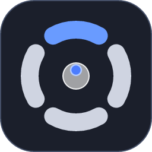

# Радиальное меню — версия на Rust



**Руководство пользователя со скриншотами — [docs/GUIDE.md](docs/GUIDE.md).**


Перенос Python-версии (ветка `python-version`; прежняя C#-версия — в `csharp-version`) на Rust: тот же внешний вид и логика
(стеклянные кнопки в стиле Actions Ring, веер подменю, подписи, громкость колесом, заметка
для Obsidian), но без Python/tkinter/Pillow — один `exe`.

Зажми боковую кнопку мыши (по умолчанию «назад») или своё сочетание клавиш — в центре экрана
появится меню. Курсор стоит на месте, меню управляется движением мыши: направление от центра
выбирает кнопку. Колесо — громкость. Отпусти — выполнится подсвеченный пункт, отпустил в центре — отмена.

## Сборка и запуск (Windows)

```
cargo build --release          # RadialMenu.exe — в target\release
cargo test                     # тесты (переносимые слои идут и на Linux/macOS)
```

## Настройки

**Значок в трее → ПКМ → «Настройки…»** (или двойной щелчок по значку). Окно нарисовано в стиле меню
и следует выбранной теме:

* **Тема** — авто / светлая / тёмная.
* **Кнопка мыши** — нет / «назад» / «вперёд».
* **Сочетание клавиш** — щёлкнуть по полю и нажать сочетание (Esc — отмена, Backspace — убрать).
  Меню открыто, пока держишь клавишу; отпустил — выполнилось. Записываются и системные сочетания
  (Win+…, Alt+…): во время записи их перехватывает хук, и они не срабатывают. Можно задать и мышь,
  и сочетание сразу — хотя бы одно обязательно.
* Размер меню, чувствительность, задержка веера, папка хранилища Obsidian, запуск с Windows,
  кнопка **«Открыть menu.yaml»**.

**Обновления.** Раз в сутки (и по пункту «Проверить обновления сейчас» в меню значка) программа спрашивает
GitHub Releases о новой версии. Нашла — показывает уведомление; щелчок по нему (или по пункту «Доступна версия X —
обновить…» в меню значка) открывает «Настройки», где в строке «Обновление» видна текущая версия и кнопка «Обновить».
По кнопке программа сама скачивает установщик (с полосой прогресса), сверяет его SHA-256 с `SHA256SUMS.txt` из того же
релиза, тихо ставит поверх и перезапускается; после этого приходит уведомление «Приложение обновлено».
Запросы идут только на `github.com` и `api.github.com`; автопроверка отключается галкой «Проверять обновления» в меню
значка или `check_updates = 0` в `config.txt`. Работает, пока репозиторий с релизами публичный. Установщик пока не
подписан сертификатом (см. `docs/TODO-security.md`), поэтому защита — проверка суммы и адреса, а не подпись.

**Игры.** Когда на переднем плане полноэкранная программа (эксклюзивный режим Direct3D или окно без рамки на весь монитор),
вызов меню не перехватывается — боковые кнопки и сочетания остаются игре, а хуки ввода на это время снимаются (ни одно движение
мыши не идёт через процесс). Браузеры и видеоплееры (`chrome.exe`, `vlc.exe`, …) играми не считаются. `ignore_apps = a.exe, b.exe` —
программы, где меню не вызывается никогда (в том числе оконные игры); `ignore_fullscreen = 0` или галка в трее выключают автоопределение.
Правило — `model::games` (переносимое, с тестами), описание активного окна — `platform/win32/input/game.rs`.

Всё хранится в `%APPDATA%\RadialMenu\` (создаётся при первом запуске):

* `config.txt` — настройки `ключ = значение`: `button` (0/1/2), `hotkey` (`ctrl+alt+space`), `vault`,
  `sens_percent`, `size_percent`, `dwell_ms`, `theme`, `ignore_fullscreen`, `ignore_apps`. Параметры `--button`, `--hotkey`, `--vault`
  действуют только на текущий запуск.
* `menu.yaml` — **состав меню** (см. ниже); `icons\` — папка для своих значков.

Значок в трее: «Настройки…», «Пауза», «Запускать с Windows», «Не мешать в играх», «Выход». Ошибки пишутся в `%TEMP%\RadialMenu_error.log`.

## Состав меню: `menu.yaml`

Файл перечитывается при следующем открытии меню. Ошибка показывается уведомлением у значка
(с номером строки или путём до места: «кнопка 3 «Медиа» → пункт 2 «Пауза»: …») и внизу окна
настроек, а меню на это время берётся стандартное. Полное описание полей и примеры — в шапке
самого файла; кратко:

```yaml
layout:
  start: top            # где первая кнопка: top | right | bottom | left | угол
  clockwise: true
  fan_spread: 60        # больше не используется: веер сам встаёт кольцом над кнопкой

menu:                   # до 12 основных кнопок — круг раздвигается сам
  - label: Блокнот
    run: notepad        # иконка программы подставится сама
  - label: VS Code
    run: { path: code, args: ".", cwd: "D:/Проекты", admin: false }
  - label: Почта
    icon: icons/mail.svg               # свой значок: одноцветный SVG красится под тему
    open: "mailto:"
  - label: Obsidian
    icon: { file: icons/obsidian.png, color: true }   # в своих цветах
    open: "obsidian://"
  - label: Скриншот
    keys: win+shift+s
    color: "#8E4EC6"                   # свой цвет подсветки
  - label: Медиа
    icon: headphones
    state: media                       # зеленеет, пока играет звук
    items:                             # веер — до 6 пунктов; у пункта может быть свой веер (до 4), глубже нельзя
      - { label: Назад, icon: backward-step, media: prev }
      - label: Пауза
        icon: pause
        media: play-pause
        when_off: { flag: media, icon: play, label: Плей }
      - { label: Вперёд, icon: forward-step, media: next }
  - label: Подпись
    text: "С уважением,\nИван"         # напечатать текст
  - label: Скопировать всё
    steps: [ { keys: ctrl+a }, { wait: 80 }, { keys: ctrl+c } ]

apps:                   # своё меню, пока активно окно этих программ
  - match: [code.exe, cursor.exe]
    menu:
      - { label: Команды, keys: ctrl+shift+p }
      - { label: Терминал, keys: "ctrl+`" }
```

* **Действия:** `keys`, `text`, `run` (имя как в «Выполнить» или путь; `args` строкой или списком,
  `cwd`, `admin`), `open` (ссылка, файл, папка, протокол), `media`, `volume`,
  `action: explorer | note | settings | screenshot-window | back | forward`, `enabled_if: desktop-prev | desktop-next`, `steps` (цепочка с `wait`; паузы отсчитывает таймер, меню и трей не зависают).
* **Иконки:** встроенные (список в файле), свой `.svg` / `.png` (путь от папки файла или полный;
  SVG — любой сложности), `{ from: путь }` — иконка любой программы или файла, `none`. Без `icon`:
  у `run` — иконка программы, у остальных — первая буква подписи.
* В путях работают переменные окружения: `"%USERPROFILE%/Downloads"`.

### Профили: разные меню на разные кнопки

В «Настройках» вверху — вкладки: «Основное» и до трёх профилей («+» добавляет). У каждой вкладки своя боковая кнопка
мыши и/или сочетание клавиш и свой файл меню: у основного `menu.yaml`, у профилей `menu-2.yaml`, `menu-3.yaml`,
`menu-4.yaml` (кнопка «Открыть …» там же; формат один и тот же). Одну кнопку или сочетание нельзя отдать двум меню —
настройки не сохранятся, пока это не поправить. По умолчанию есть профиль 2 «Навигация» на боковую «вперёд» — жесты
в четыре стороны: влево/вправо — рабочий стол назад/вперёд (на первом/последнем столе соответствующая кнопка приглушена:
`enabled_if`), вверх — скриншот области (`Win+Shift+S`), с задержкой — скриншот окна под указателем
(`screenshot-window`), вниз — веер из двух кнопок «Страницы»: назад/вперёд в окне под указателем (`back` / `forward`).
Шаблон профиля записывается при первом запуске; уже созданный `menu-2.yaml` не меняется.

## Темы

Светлая и тёмная — для меню, плашек подписей, окна настроек и окна заметки. В режиме «Авто»
тема берётся из системы и меняется на лету:

* Windows — `AppsUseLightTheme` в реестре, смена ловится по `WM_SETTINGCHANGE` («ImmersiveColorSet»);
* macOS — `defaults read -g AppleInterfaceStyle`;
* Linux и др. — `gsettings` (`color-scheme`, затем `gtk-theme`), затем `~/.config/kdeglobals` (KDE), затем `GTK_THEME`.

Определение темы (`platform::theme`) собирается и тестируется на всех ОС; само приложение
(хук мыши, окна, трей) пока есть только для Windows. Подписи меню заранее нарисованы для обеих
тем, поэтому смена темы мгновенная и не требует шрифта.

## Архитектура

Слои лежат по папкам; каждый зависит только от слоёв выше в таблице. Всё, кроме
`platform/win32`, не знает про Windows — это даёт тесты и предпросмотр на любой ОС.

| Слой | Папка | Что делает |
|---|---|---|
| данные | `model/` | дерево меню (арена, данные вместо замыканий), меню по программам, файл `menu.yaml` (схема, проверка, шаблон), действия и сочетания клавиш, иконки, настройки, тема |
| логика меню | `engine/` | геометрия, размеры (круг и веер раздвигаются под число кнопок), раскладка, выбор по углу/задержке/гистерезису, анимация, сборка кадра |
| графика | `render/` | иконки (встроенные, свои SVG через resvg и PNG, цветные и одноцветные, буквы), предрисовка масок (tiny-skia), композитор BGRA с «грязным» прямоугольником, палитры тем, рисование окон |
| заметки | `notes/` | индекс хранилища и сохранение Ring_NN.md (`vault`), правки текста `[[ссылок]]` (`editor`) |
| окна без ОС | `ui/` | окно настроек: раскладка, попадание мышью, правка черновика, отрисовка |
| платформа | `platform/` | `theme` — тема системы (все ОС); `win32/` — `app` (сборка), `input/` (хуки мыши и клавиатуры, SendInput), `ui/` (слой меню, трей, заметка, настройки), `system/` (звук, автозапуск, файлы, программы и их иконки, диалоги) |

Правило состояния в `win32`: у каждого окна своё состояние в своём `Slot` на главном потоке
(см. `platform/win32/slot.rs`); поток хуков трогает только атомики `input::hook`, закрытые
за узким интерфейсом, и общается с окнами сообщениями.

Как добавить: пункт меню — в `menu.yaml` (меню по умолчанию — `model::menu::default_menu` и
`model/menu_template.yaml`, тест следит, чтобы они совпадали); новое действие — вариант `Action`,
поле в `model/menu_yaml.rs` и исполнение в `platform/win32/app.rs`; встроенная иконка — файл в
`assets/icons` + строка в `render/assets.rs`; новый источник состояния кнопки (как «играет звук») —
вариант `Flag` + его опрос в `app.rs`.

## Что сделано для экономии ресурсов

* **Простой = ноль.** Главный поток спит в `MsgWaitForMultipleObjectsEx`; кадровый таймер заводится
  только пока меню на экране. Опрос громкости идёт только на открытом меню и только если в меню
  есть кнопки, которым он нужен.
* **Без картинок в кадре.** Кнопка — одна маска (тень/круг/обводка, ~80 КБ) + маски иконок;
  цвет и состояния смешиваются прямо при композитинге, поэтому нет набора «состояние × иконка».
* **Обновляется только изменённое.** Композитор считает «грязный» прямоугольник, окно обновляется
  через `UpdateLayeredWindowIndirect` с этим прямоугольником; частота кадров — по частоте монитора.
* **Шрифт живёт только при сборке меню, при смене трека (≈10 мс) и пока открыты настройки.** Замер кучи — `cargo run --release --example memprobe`.
* Хуки мыши и клавиатуры — отдельный поток, колбэки трогают только атомики (ответ в микросекундах).
  Сторож переставляет хуки, только если они перестали отвечать (курсор двигается, а колбэк молчит), и не чаще раза в 2 с.
* Меню по программам собираются заранее; при вызове только выбирается нужное по имени exe активного окна.

## Проверка

Логика (навигация, раскладка, анимация, растеризация и иконки, композитор, темы, `menu.yaml` и его шаблон,
сочетания клавиш, правки заметки, окно настроек, сторож хука) покрыта тестами и выполняется на любой ОС;
поиск программ и их иконки проверяются тестом на Windows. CI собирает и тестирует на
`windows-latest` (`cargo test`, `cargo clippy`, `cargo build --release`).

Предпросмотр кадров меню и окна настроек в PNG:
`cargo run --release --example preview -- папка [light|dark|auto] [menu.yaml]` (`SCALE=1.5` — другой масштаб);
с путём к `menu.yaml` рисуется и ваше меню.
Картинки для руководства (`docs/img`): `cargo run --release --example docshots -- docs/img`.

### Ручная проверка на Windows

1. Запуск: значок в трее, второй запуск exe молча выходит (один экземпляр).
2. Зажать боковую «назад»: меню появляется в центре монитора с курсором, курсор не двигается, кнопки появляются по очереди.
3. Вверх/вправо/вниз/влево — подсветка блока; «Открыть» раскрывает веер сразу, «Вставить»/«Копировать» — после ~0,45 с.
4. Отпустить на «Вставить» — вставка (Ctrl+V); в центре — отмена; колесо при открытом меню — громкость и подпись.
5. «Медиа» зеленеет и пишет «играет», пока звучит аудио; «Пауза/Плей» переключает.
6. «Заметка»: окно по центру, набор `[[` → `[[]]` и список; стрелки/Enter/Tab/клик подставляют ссылку; Ctrl+Enter сохраняет Ring_NN.md; Esc закрывает. Без хранилища — подсказка открыть настройки.
7. Трей, ПКМ → «Настройки…»: окно в теме меню; ползунки тянутся мышью и колесом; «Обзор…» выбирает папку; «Сохранить» применяет сразу (размер меню, кнопка, тема), Esc/× закрывают без сохранения.
8. Тема «Авто»: переключить тему Windows (Параметры → Персонализация → Цвета) — меню, открытые настройки и заметка перекрашиваются без перезапуска.
9. «Открыть menu.yaml», поменять подпись, открыть меню — подпись новая; испортить строку — уведомление с номером строки, меню по умолчанию.
10. В настройках записать сочетание (например, Ctrl+Alt+Space, Win+Z): держать — меню открыто, отпустить — действие; Alt/Win после этого не открывают меню окна и «Пуск».
11. `menu.yaml`: `run: notepad` — кнопка с иконкой Блокнота, запускает его; `admin: true` — спрашивает UAC; свой `.svg`/`.png` из `icons`; `color`; 10–12 кнопок по кругу; веер на 6; вложенный веер (пункт веера с `items`) раскрывается при наведении.
12. `apps:` с `match: [code.exe]` — в VS Code открывается своё меню, в других программах — общее.
13. Трей: «Пауза» возвращает обычную работу боковой кнопки и сочетания; «Выход» убирает значок и процесс.
14. Через RDP меню работает по координатам (курсор возвращается на место нажатия).
15. Игры: в полноэкранной игре боковая кнопка работает как обычно, в журнале строка «хуки ввода сняты»; свернули игру — меню снова вызывается, в журнале «поставлены». Оконная игра — после `ignore_apps = имя.exe` то же самое. В полноэкранном видео в браузере меню по-прежнему работает.

### Логотип

`assets/RadialMenu.ico` (10 размеров, 16–256 px: под масштаб 100–250 %) собран из векторного описания: `cargo run --release --example make_icon -- assets`. Для трея — отдельные значки без плитки (`tray-dark.ico` и `tray-light.ico`): программа берёт тот, что виден на текущей панели задач, и меняет его при смене темы Windows.
Для 16/24/32 px — упрощённые варианты (толще кольцо, меньше деталей), чтобы значок читался в трее. Иконка используется в трее и встраивается в exe (`build.rs`).
