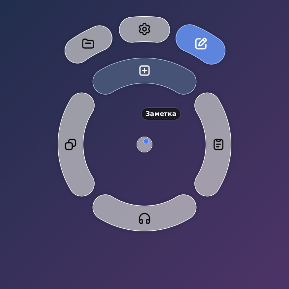
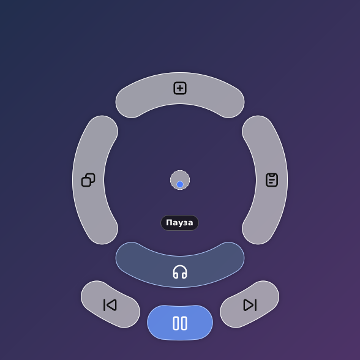
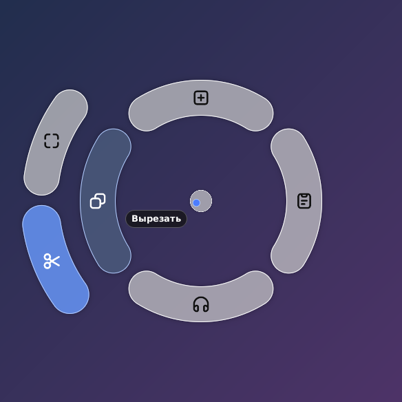
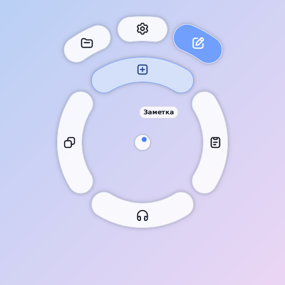
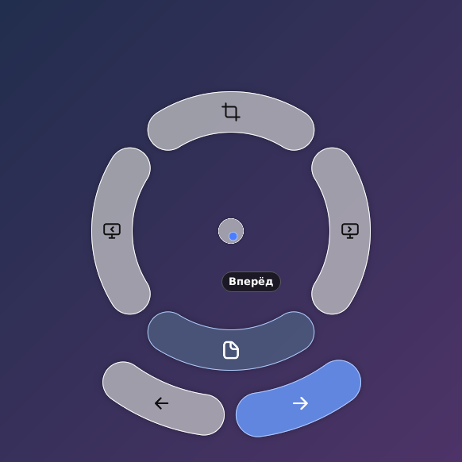
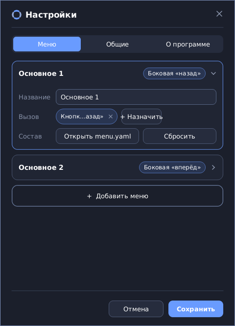
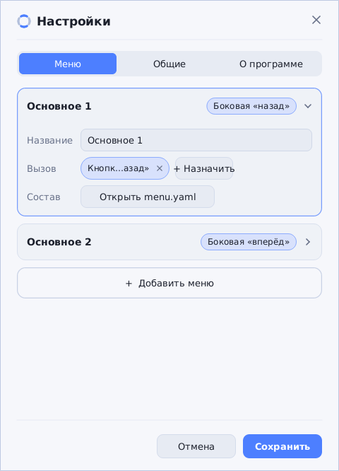
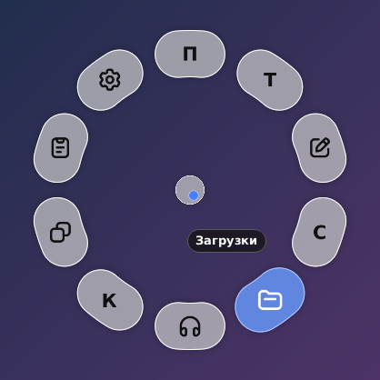

# Радиальное меню — руководство пользователя

Радиальное меню — маленькая программа для Windows: зажимаешь боковую кнопку мыши, и под рукой появляется
круг с нужными действиями. Не отпуская кнопку, ведёшь мышь в сторону нужной кнопки и отпускаешь — действие
выполнено. Курсор при этом стоит на месте: меню управляется направлением движения, а не точным попаданием.



*Меню «Открыть»: основные кнопки по кругу, у выбранной раскрылся веер (Параметры, Проводник, Заметка).*

## Содержание

1. [Установка и первый запуск](#установка-и-первый-запуск)
2. [Как пользоваться](#как-пользоваться)
3. [Меню по умолчанию](#меню-по-умолчанию)
4. [Второе меню «Навигация»](#второе-меню-навигация)
5. [Настройки](#настройки)
6. [Своё меню: menu.yaml](#своё-меню-menuyaml)
7. [Заметка для Obsidian](#заметка-для-obsidian)
8. [Игры и полноэкранные программы](#игры-и-полноэкранные-программы)
9. [Значок в трее, обновления, файлы](#значок-в-трее-обновления-файлы)
10. [Если что-то не работает](#если-что-то-не-работает)

## Установка и первый запуск

Скачайте со страницы **Releases** репозитория один из двух файлов:

* `RadialMenu-Setup-X.Y.Z.exe` — установщик. Ставится на текущего пользователя, права администратора не нужны,
  новую версию можно ставить поверх старой. При удалении автозапуск снимается, а настройки остаются.
* `RadialMenu-X.Y.Z-portable.zip` — переносимая версия: один `RadialMenu.exe`, который можно запускать откуда угодно.

После запуска в области уведомлений (трее) появляется значок. Окна у программы нет — она работает в фоне.
Если значка не видно, он спрятан под стрелкой «Показать скрытые значки».

По умолчанию меню вызывается боковой кнопкой мыши «назад» (та, что под большим пальцем ближе к вам).
Назначить другую кнопку или сочетание клавиш можно в [настройках](#настройки).

> Пока программа запущена, боковая кнопка «назад» больше не листает страницы в браузере: она вызывает меню.
> Чтобы вернуть ей прежнюю работу, выберите в трее «Пауза» или назначьте меню другую кнопку.

## Как пользоваться

1. **Зажмите** боковую кнопку мыши. В центре экрана (на мониторе, где стоит курсор) появится меню.
2. **Ведите мышь** в сторону нужной кнопки. Курсор остаётся на месте, а синяя точка в центре меню показывает,
   куда вы целитесь. Выбранная кнопка подсвечивается, рядом появляется подпись.
3. **Отпустите** кнопку мыши — действие выполнится.

Что ещё нужно знать:

* **Отмена.** Отпустите кнопку, когда точка в центре (в «мёртвой зоне») или ни одна кнопка не подсвечена, — ничего не произойдёт.
* **Веера.** У некоторых кнопок есть подменю — веер из дополнительных кнопок над ней. Он раскрывается, когда вы наведётесь
  на кнопку; чтобы выбрать пункт веера, продолжайте движение в ту же сторону.
* **Задержка.** У «Вставить» и «Копировать» веер раскрывается, только если задержаться на кнопке (≈0,45 с, настраивается),
  а если отпустить сразу — выполнится сама кнопка (вставка или копирование).
* **Колесо мыши.** Пока меню открыто, колесо меняет громкость, а внизу показывается подпись «Громкость + / −».
* **Меню не зависает.** Если по какой-то причине отпускание кнопки потерялось, меню закроется само.

## Меню по умолчанию

| Кнопка | Что делает | Веер |
|---|---|---|
| **Открыть** (сверху) | — | Проводник, Параметры Windows, окно быстрой заметки |
| **Вставить** (справа) | `Ctrl+V` | Буфер обмена (`Win+V`) — после задержки |
| **Медиа** (снизу) | — | Назад, Пауза/Плей, Вперёд; кнопка зеленеет, пока что-то играет |
| **Копировать** (слева) | `Ctrl+C` | Выбрать все, Вырезать — после задержки |

Кнопка «Медиа» работает с любым плеером, который показывает себя в Windows (браузер, Spotify и т. п.). Пока играет звук,
кнопка подсвечена зелёным, а на паузе показывается «Плей». Под кольцом веера плеера видно, что сейчас играет.





Тему меню (светлую или тёмную) можно выбрать в настройках; в режиме «Авто» она следует за темой Windows:



## Второе меню «Навигация»

Кроме основного, по умолчанию есть второе меню — на боковую кнопку «вперёд». Это жесты в четыре стороны:



| Куда вести | Действие |
|---|---|
| Влево | Рабочий стол назад (`Ctrl+Win+←`) |
| Вправо | Рабочий стол вперёд (`Ctrl+Win+→`) |
| Вверх | Скриншот области (`Win+Shift+S`); с задержкой — веер «Скриншот окна» |
| Вниз | Веер из двух кнопок «Страницы»: «Назад» и «Вперёд» (как боковые кнопки мыши в браузере и Проводнике) |

На первом рабочем столе кнопка «Стол назад» приглушена и не выбирается, на последнем — «Стол вперёд».
«Назад», «вперёд» и скриншот окна действуют на окно **под указателем**, а не на активное.

> Меню профиля создаётся из шаблона при первом запуске. Если у вас уже есть `menu-2.yaml` со старой раскладкой
> (назад/вперёд по бокам, столы снизу), он не меняется: удалите файл — и при следующем запуске появится новая раскладка.

Таких меню (профилей) можно завести до трёх сверх основного, у каждого — своя кнопка мыши и/или сочетание клавиш и свой файл меню.

## Настройки

Откройте их из трея: **ПКМ по значку → «Настройки…»** (или двойной щелчок по значку).



| Параметр | Что значит |
|---|---|
| Вкладки «Основное», «Профиль N», «+» | Меню и способ его вызова; «+» добавляет профиль (до трёх) |
| Кнопка мыши | Нет / «Назад» / «Вперёд». Одну кнопку нельзя отдать двум меню |
| Сочетание клавиш | Щёлкните по полю и нажмите сочетание (`Esc` — отмена, `Backspace` — убрать). Меню открыто, пока держите клавишу. Можно записать и системные сочетания (`Win+…`, `Alt+…`). Мышь и сочетание можно использовать вместе, но хотя бы одно обязательно |
| Состав меню | Кнопка «Открыть menu.yaml» — файл с составом меню, см. [следующий раздел](#своё-меню-menuyaml) |
| Тема | Авто (как в Windows) / Светлая / Тёмная |
| Размер меню | 50–150 % |
| Чувствительность | Как далеко нужно сдвинуть мышь, чтобы выбрать кнопку (20–300 %) |
| Задержка веера | Сколько держать кнопку, чтобы раскрылся веер у «Вставить» и «Копировать» (100–2000 мс) |
| Хранилище заметок | Папка Obsidian для [заметок](#заметка-для-obsidian); «Обзор…» открывает выбор папки |
| Запуск с системой | Автозапуск при входе в Windows |
| Обновление | Текущая версия и кнопка проверки/обновления |

«Сохранить» применяет настройки сразу, `Esc` и крестик закрывают окно без сохранения.

Светлая тема окна:



## Своё меню: menu.yaml

Состав меню лежит в обычном текстовом файле. Откройте его кнопкой «Открыть menu.yaml» в настройках (или найдите в
`%APPDATA%\RadialMenu\menu.yaml`). В самом файле есть подробные комментарии и закомментированные примеры — достаточно
убрать `#` перед нужными строками. Файл перечитывается сам; при ошибке вы увидите уведомление с номером строки,
а меню на это время станет стандартным.



Пример:

```yaml
menu:                       # до 12 основных кнопок — круг раздвигается сам
  - label: Блокнот
    run: notepad            # значок программы подставится сам
  - label: Скриншот
    keys: win+shift+s       # нажать сочетание
    color: "#8E4EC6"        # свой цвет подсветки
  - label: Загрузки
    icon: folder
    open: "%USERPROFILE%/Downloads"
  - label: Медиа
    icon: headphones
    state: media            # зеленеет, пока играет звук
    items:                  # веер — до 6 пунктов
      - { label: Назад, icon: backward-step, media: prev }
      - { label: Пауза, icon: pause, media: play-pause }
      - { label: Вперёд, icon: forward-step, media: next }

apps:                       # своё меню, пока активно окно этих программ
  - match: [code.exe, cursor.exe]
    menu:
      - { label: Команды, keys: ctrl+shift+p }
      - { label: Терминал, keys: "ctrl+`" }
```

Что умеет кнопка: нажать сочетание (`keys`), напечатать текст (`text`), запустить программу (`run`, в том числе
от администратора), открыть ссылку, папку или файл (`open`), управлять плеером и громкостью (`media`, `volume`),
выполнить цепочку действий с паузами (`steps`). Значки — встроенные, свои `.svg`/`.png`, значок любой программы
или просто буква. Полное описание всех полей — в [README](../README.md#состав-меню-menuyaml).

## Заметка для Obsidian

Пункт «Заметка» (в меню «Открыть») открывает небольшое окно для быстрой записи мысли в хранилище Obsidian.

1. Один раз укажите папку хранилища: в настройках («Хранилище заметок») или прямо в окне заметки.
2. Наберите текст. Название файла можно изменить в поле вверху; по умолчанию это `Ring_NN`.
3. Нажмите `Ctrl+Enter` (или кнопку «Сохранить») — в корне хранилища появится файл `Ring_NN.md`, Obsidian подхватит его сам.
   Существующие файлы никогда не перезаписываются. `Esc` закрывает окно без сохранения.

Как в Obsidian, набор `[[` открывает список заметок хранилища: он фильтруется по набору, стрелки, `Enter` и `Tab` подставляют
ссылку, а `[[` автоматически закрывается `]]`.

## Игры и полноэкранные программы

В играх у боковых кнопок мыши и клавиш свои назначения. Чтобы меню им не мешало, программа **сама не вмешивается**,
когда на переднем плане полноэкранное приложение:

* игра в эксклюзивном полноэкранном режиме (Direct3D);
* окно без рамки и заголовка, закрывающее весь монитор (режим «окно без рамки» / borderless).

В этом случае нажатие боковой кнопки (или сочетания) уходит в игру как обычно, меню не появляется. Пока игра активна,
программа вообще снимает свои перехватчики ввода — движения мыши и нажатия клавиш не проходят через неё и не добавляют
задержку. Как только вы свернёте игру или переключитесь в другую программу, перехват возвращается (в пределах четверти секунды).

**Исключения.** Браузеры и видеоплееры (Chrome, Edge, Firefox, VLC, mpv и др.) считаются не играми: в полноэкранном
видео меню по-прежнему работает — там пригодятся «Пауза» и громкость.

**Свой список программ.** Если игра работает в обычном окне или её нужно исключить вручную, добавьте её в `config.txt`
(`%APPDATA%\RadialMenu\config.txt`) — имена exe через запятую, регистр не важен:

```
ignore_apps = dota2.exe, eldenring.exe
```

В этих программах меню не вызывается никогда (даже в окне). Узнать имя exe можно в Диспетчере задач на вкладке «Подробности».

**Выключить автоопределение полноэкранных.** В трее снимите галку «Не мешать в играх (полный экран)» или поставьте
в `config.txt` `ignore_fullscreen = 0`. Список `ignore_apps` при этом продолжает работать.

Изменения в `config.txt` подхватываются сами в течение нескольких секунд. Когда перехватчики снимаются и возвращаются,
это записывается в журнал.

## Значок в трее, обновления, файлы

**Меню значка** (ПКМ): «Настройки…», «Пауза» (вернуть боковым кнопкам обычную работу), «Запускать с Windows»,
«Не мешать в играх (полный экран)», «Проверять обновления», «Проверить обновления сейчас», «Открыть журнал», «Выход».

**Обновления.** Раз в сутки программа спрашивает GitHub Releases, не вышла ли новая версия. Если вышла — покажет уведомление;
щелчок по нему открывает «Настройки», где кнопка «Обновить» скачает установщик, сверит контрольную сумму, поставит новую
версию поверх и перезапустит программу. Запросы идут только на `github.com` и `api.github.com`; проверку можно отключить
галкой в меню значка. Установщик пока не подписан сертификатом, поэтому Windows может показать предупреждение SmartScreen.

**Где лежат файлы** — в `%APPDATA%\RadialMenu\`:

| Файл | Что это |
|---|---|
| `config.txt` | Настройки (то же, что в окне «Настройки», плюс `ignore_apps`) |
| `menu.yaml` | Состав основного меню |
| `menu-2.yaml` … `menu-4.yaml` | Меню профилей |
| `icons\` | Ваши значки для меню |
| `RadialMenu.log` | Журнал запуска, ошибок и аварий |

## Если что-то не работает

* **Меню не появляется.** Проверьте, что значок программы есть в трее и не стоит «Пауза»; что в настройках выбрана та боковая
  кнопка, которая у вашей мыши есть; что активна не игра и не программа из `ignore_apps` (см. выше). Часть мышей присылает
  боковые кнопки только через собственную утилиту производителя — в ней кнопка должна быть назначена как «Назад»/«Вперёд».
* **Меню не вызывается в программе, запущенной от администратора.** Windows не даёт обычной программе перехватывать ввод
  в окнах с повышенными правами. Запустите «Радиальное меню» от администратора.
* **Боковая кнопка перестала работать в браузере.** Так и задумано, пока программа запущена. «Пауза» в трее возвращает
  кнопке прежнюю работу; можно также назначить меню сочетание клавиш, а кнопку оставить как есть.
* **Меню открывается не на том мониторе.** Меню появляется на мониторе, где стоял курсор в момент нажатия.
* **По удалённому рабочему столу (RDP).** Работает: меню следит за координатами указателя, а не за «сырым» вводом.
* **Ошибка в menu.yaml.** Появляется уведомление у значка с номером строки; до исправления работает стандартное меню.
* **Что-то сломалось.** Откройте журнал (трей → «Открыть журнал») — там записаны запуск, ошибки и аварии; приложите его к обращению.

## Для разработчиков

Устройство программы, сборка и проверка описаны в [README](../README.md). Картинки этого руководства нарисованы тем же кодом,
что и само меню, командой `cargo run --release --example docshots -- docs/img` — после изменений интерфейса их можно обновить.
